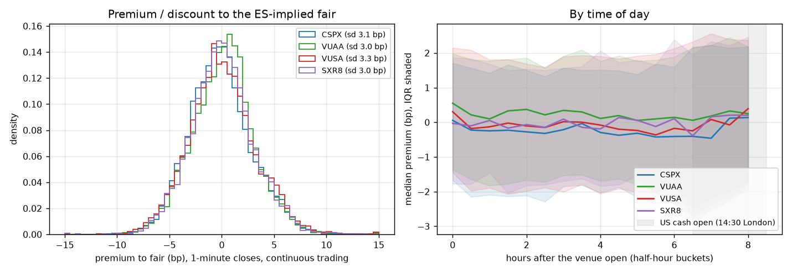
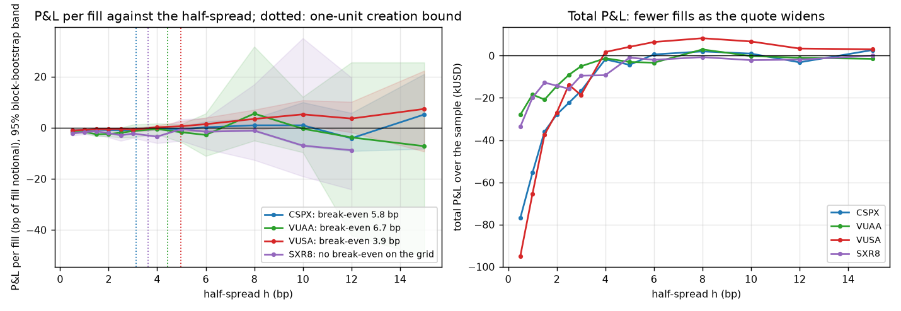
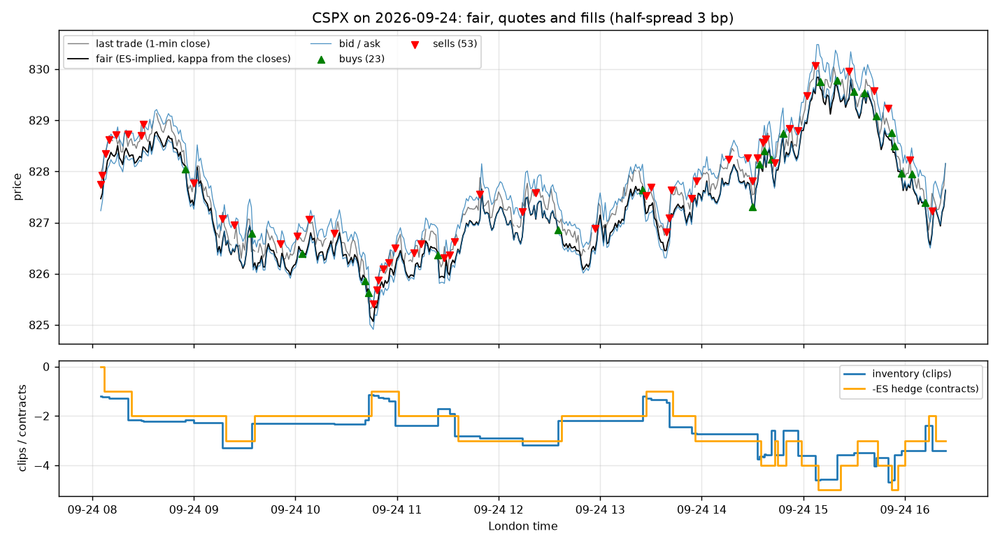
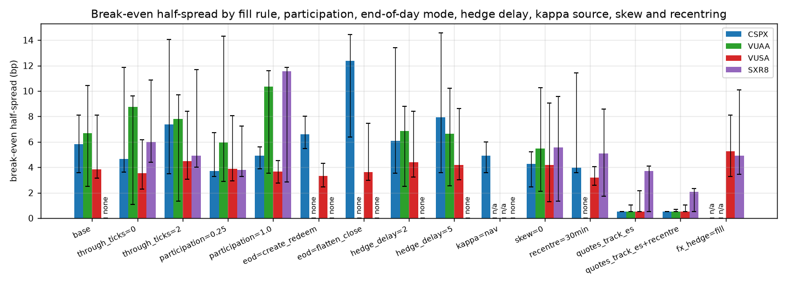
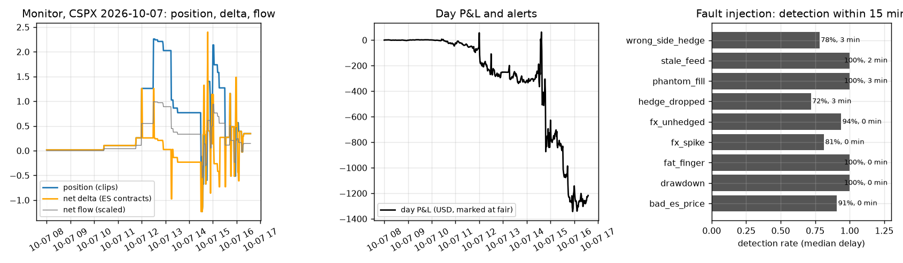

# etf-mm-europe — a futures-hedged two-way quote on UCITS S&P 500 ETF lines: the spread that clears the creation bound, and what a fill earns

**Question.** A market maker quotes a UCITS S&P 500 ETF on the London and Frankfurt order books and hedges every fill in the E-mini, with the FX leg hedged daily. How wide must the two-way quote be to clear the creation/redemption arbitrage bound and the hedge cost, and what does the quoter earn per fill, by line (CSPX and VUAA in USD on the LSE, VUSA in GBP on the LSE, SXR8 in EUR on Xetra)?

**Answer (§Results).** On 20 days of 1-minute bars (2026-09-09 to 2026-10-07), with quotes fixed for each minute and a fill only when the bar trades one tick through the quote (the pessimistic reading of a bar), the break-even half-spread is **CSPX** 5.8 bp [3.5, 8.1] against a one-unit bound of 3.1 bp (0.5 bp [0.5, 0.5] when the quotes follow ES inside the minute); **VUAA** 6.7 bp [2.5, 10.6] against a one-unit bound of 4.4 bp (0.5 bp [0.5, 1.0] when the quotes follow ES inside the minute); **VUSA** 3.9 bp [3.2, 8.3] against a one-unit bound of 5.0 bp (0.5 bp [0.5, 2.2] when the quotes follow ES inside the minute); **SXR8** no break-even on the grid (bootstrap [4.3, 11.5]) against a one-unit bound of 3.6 bp (3.7 bp [0.5, 4.1] when the quotes follow ES inside the minute). The one-unit bound is 3.1–5.0 bp (fixed fee amortised over one unit, basket half-spread, E-mini half-tick and fee, one FX conversion for the GBP and EUR lines, one day of T+2/T+1 settlement financing) and 2.8–3.4 bp over ten units; the hedge cost alone is 0.20 bp. With fixed quotes 1 of the 4 lines clears the one-unit bound; with quotes that track ES inside the bar 3 of 4 do. At the base half-spread of 3 bp the fixed-quote book loses 0.8 to 2.3 bp per fill: it captures 2.7–3.2 bp against the fair at the fill and gives 1.8–4.7 bp back between the fill and the hedge one minute later, because a bar that trades through a quote is mostly a bar in which the index moved. The lines sit within 3.0–3.3 bp (sd) of the ES-implied fair, 2.0–2.3 bp within the day, and close 2.1–6.0 bp rich to the issuer's NAV-fair where a NAV exists. The monitor's fault-injection score is 91% detection within 15 minutes with 0.26 alerts per clean line-day.

- *Fair value.* $E^* = I_{\mathrm{fair}} / (\kappa_d X)$: the E-mini with the cost of carry removed and the quarter's dividend accrual added back (the vendored model), less the contract's richness to the cash index (2026-09-18: -1.6 bp, 2026-12-18: +8.5 bp; the September contract's two weeks of carry and the December contract's three months are both measured, not assumed), divided by the fund/index ratio struck from the previous closes and by the spot rate. Yahoo's continuous ES=F switched from the 2026-09-18 to the 2026-12-18 contract at 2026-09-14 15:30 UTC (a 90 bp one-minute jump that the cash index confirms); every bar carries its own contract and the hedge rolls there.
- *Premium.* The four lines are within 3.0–3.3 bp (sd) of fair at the minute and 9–12 % of minutes are more than 5 bp away; the premium to the issuer's NAV is persistent: CSPX closes a median 2.1 bp and SXR8 5.1 bp above NAV-fair over the 21 NAV days, so a quoter centred on NAV would be sold to all day — the quoter here centres on where the line itself closed (kappa from the closing prints), and the `kappa=nav` row of the sensitivity table shows the cost of centring on NAV.
- *FX.* Hedging the FX leg once a day costs the GBP and EUR lines 1.0 bp per fill (VUSA) and 1.9 bp per fill (SXR8) at h = 3: the quoter's net flow runs against the day's spot move (daily FX P&L against net flow x spot change is negatively correlated on both lines), so the local cash it holds until the conversion is on the wrong side of it. Converting each fill's cash at the next bar instead pays the conversion spread on every fill: on VUSA the FX component at h = 3 goes from -1.0 to -1.2 bp and the break-even from 3.9 to 5.2 bp; on SXR8 the FX component at h = 3 goes from -1.9 to -1.1 bp and the break-even from none on the grid to 4.9 bp — it removes the exposure on the thin EUR line and only adds cost on the busy GBP line, so the FX policy is a per-line choice, not a rule.
- *Attribution.* Per fill at h = 3 bp: CSPX: capture 2.7, hedge slippage -3.2, FX 0.0, inventory -0.2, fees -0.3, total -1.0 bp (1266 fills, -13 USD per fill); VUAA: capture 3.2, hedge slippage -4.7, FX 0.0, inventory 0.5, fees -0.3, total -1.3 bp (471 fills, -11 USD per fill); VUSA: capture 2.7, hedge slippage -1.8, FX -1.0, inventory -0.4, fees -0.3, total -0.8 bp (1901 fills, -10 USD per fill); SXR8: capture 2.9, hedge slippage -3.2, FX -1.9, inventory 0.2, fees -0.3, total -2.3 bp (820 fills, -12 USD per fill). The identity cash + inventory at the closing mark = capture + slippage + FX + inventory + fees holds to 1e-6 USD on every run.
- *The two brackets.* With quotes fixed for the minute, a fill is a stale quote hit after the index moved: the quoter captures the half-spread against the bar-start fair and gives most of it back before the hedge (hedge slippage -4.7 to -1.8 bp per fill at h = 3). With quotes that follow the ES bar's range (`quotes_track_es`), every fill is at the minute's extreme and the mark then reverts towards the close, so the slippage turns positive and the break-even falls to the bottom of the grid; that is the optimistic reading. A quoter re-pricing on every ES tick with a known queue position lies between the two columns; the bars cannot place it, and §Limits says so. The end-of-day choice (carry the hedged inventory, flatten at the close, redeem at NAV less the one-unit bound), the hedge delay, the inventory skew and the participation cap move the break-even less than the fill rule does (§Results).

Data checked 2026-10-07. Python package `etfmm` (numpy/pandas), 19 tests, CI runs the pipeline on the checked-in data. The faulted monitor days are simulated and said so; everything else is the replay on Yahoo's bars. 1-minute bars are not a tick book: the quoter re-prices once a minute (or follows the ES bar's range in the tracking case), queue position is unknown, and the sample is 30 calendar days.

---

## Layout

```
scripts/download.py     Yahoo daily bars since 2019 and 1-minute bars over the trailing 30 days (the API limit; appended on each run) for
                        CSPX.L VUAA.L VUSA.L SXR8.DE SPY ^GSPC ES=F GBPUSD=X EURUSD=X; Treasury par curve, NY Fed SOFR/EFFR, ECB ESTR,
                        BoE SONIA; the iShares product-data API (daily NAV since 2010, key facts, listings); the Vanguard professional
                        product pages (latest NAV, a short price table); data/reference/issuer_status.json records every attempt
etfmm/vendor/           copied from m-ichaels/delta-one-basis (NOTICE): the Yahoo loader, the cost-of-carry fair value, the dividend
                        accrual profile, the bill-curve interpolation, the expiry calendar
etfmm/calendar.py       LSE and Xetra sessions, minutes from the open, the US cash session
etfmm/fairvalue.py      the contract each ES bar carries (the switch inside expiry week), the implied index and its richness by contract,
                        the minute frame per line (inputs as of the bar start, with their ages), kappa from the closes and from the NAV
etfmm/reference.py      the tick each line trades on, inferred from the prints; the session grid the bars cover
etfmm/bound.py          the creation/redemption bound by unit count
etfmm/quoter.py         the quoter replay: skewed quotes, pull rules, the bar fill rule, the E-mini hedge, the daily FX conversion,
                        the end-of-day modes, the five-way attribution with its identity
etfmm/stats.py          break-even half-spread, circular block bootstrap over days
etfmm/monitor.py        the positions monitor (position, flows, delta, FX exposure, stale/stuck quotes, hedge slip, bands, drawdown,
                        reconciliation) and the fault-injection harness
scripts/                build_fair.py, run_bound.py, run_quoter.py, run_monitor.py, make_figures.py, summarize.py, readme.py, run_all.sh
configs/                lines.json (the four lines), params.json (every assumption), sources.json (the documents each fact came from)
tests/                  known-answer tests on small fixtures
data/reference/         daily bars, dividends, rates, issuer files;  data/intraday/  the 1-minute archive;  data/derived/  frames, fills, paths
results/                summary.md and the machine-written files the README is built from;  figures/  the png files
```

Install: `pip install -e .[test]`; `python -m pytest`; `scripts/run_all.sh [--skip-download] [--fast]` (download, fair value, bound, quoter, monitor, figures, summary, README, tests; about 4 minutes after the downloads). `python scripts/readme.py --check` fails CI when the README no longer matches the results.

---

## Data

| layer | source | span | notes |
|---|---|---|---|
| ETF lines, 1-minute | Yahoo chart API, `CSPX.L VUAA.L VUSA.L SXR8.DE`, 7-day windows over the trailing 30 days | 2026-09-08 – 2026-10-07, 21 trading days | CSPX: 494 printed minutes a day, 256,483 shares a day; VUAA: 460 printed minutes a day, 777,157 shares a day; VUSA: 508 printed minutes a day, 742,623 shares a day; SXR8: 352 printed minutes a day, 24,107 shares a day; a minute with no trade keeps a NaN close |
| hedge and FX, 1-minute | Yahoo `ES=F` (continuous front month), `GBPUSD=X`, `EURUSD=X`; `SPY`, `^GSPC` for the dividend model and the richness | same | ES prints every London minute; the FX series are indicative mids; the contract switch is detected per bar (§Method) |
| daily | the same symbols since 2019 with SPY's distributions | 2019 – 2026-10-07 | SPY's dividends and its accrual profile against the index give the index dividend points |
| financing | US Treasury par curve 1m–1y, NY Fed SOFR and EFFR, ECB €STR, BoE SONIA | 2019 – | the carry uses bills interpolated to the contract's tenor; the bound uses SOFR for the settlement day |
| issuer NAV | iShares product-data API: daily NAV of the Core S&P 500 UCITS ETF since 2010 (ok 4170 rows); Vanguard professional pages: the latest NAV and a short price table (ok 4 rows, ok 5 rows) | to 2026-10-07 | the old iShares `.ajax` csv endpoints and the Vanguard investor-site json endpoints return the page html (recorded in `data/reference/issuer_old/`); the Vanguard NAV history is therefore four to five days, used as a check only |
| reference facts | iShares VII plc prospectus; Vanguard Funds plc prospectus (2 June 2026) and the 16 Jan 2023 creation-unit notice; LSE MIT201; Deutsche Börse Xetra trading parameters (1 Dec 2025); RTS 11 tick table | read 2026-10-07 | `configs/sources.json` quotes each passage; creation unit 60,000 shares (Vanguard, published), 50,000 (iShares, not published, assumption); creation fees are 'available from the Investment Manager' at both issuers, so the fixed fee is an assumption with a sensitivity |
| not available, and said so | the LSE Business Parameters tick schedule (an xlsx the pipeline could not locate), the issuers' actual creation fees and the iShares unit size, Vanguard's daily NAV history (the investor-site json endpoints return html), any order-book or tick data | — | ticks are inferred from the prints; the fees are assumptions with sensitivities; the Vanguard NAV is the page's last five days; the bar fill rule stands in for the book |

Ticks inferred from the prints: CSPX 0.01 USD (98.3% of 41,392 prices on the grid); VUAA 0.02 USD (96.8% of 38,708 prices on the grid); VUSA 0.0025 GBP (94.5% of 42,696 prices on the grid); SXR8 0.02 EUR (100.0% of 29,780 prices on the grid). The RTS 11 band-6 table would put SXR8 at 0.10 EUR; the Xetra prints sit on 0.02, so the prints are used.

---

## Method

**Fair value.** For the E-mini $F$, financing $r$ (bills to the contract's expiry, act/360), expected index dividend points $D$ to expiry (the point-in-time forecast of SPY's distribution, grossed up by its fee, through the accrual profile measured from SPY against the index), and the contract's richness $\rho_c$ (the median of $10^4 (I_{\mathrm{impl}} - I)/I$ over the US cash session while $c$ is the front):

$$I_{\mathrm{impl}} = \frac{F + D}{1 + r\tau},\qquad I_{\mathrm{fair}} = I_{\mathrm{impl}}\,(1 - \rho_c/10^4),\qquad E^*_{\mathrm{USD}} = \frac{I_{\mathrm{fair}}}{\kappa_d},\qquad E^* = \frac{E^*_{\mathrm{USD}}}{X},\qquad \mathrm{prem} = 10^4\,\frac{P - E^*}{E^*}.$$

$\kappa_d$ is index over fund price. The quoter's $\kappa_d$ is the median over the previous 5 closes of $I_{\mathrm{fair}}/(P X)$ in the last 30 minutes of each session, each drifted to day $d$ for the fee (7 bp a year), the dividend accrual between the two dates and, for the distributing line, its own ex-date. The NAV $\kappa$ is the S&P 500 close over the issuer's NAV on the last NAV date before $d$ with the same drifts; `prem_nav` is the premium to that fair. The fair at the start of bar $t$ uses the last ES and FX bars that closed by $t$; a bar's own ES range is used only by the tracking quoter.

**Contract.** Each ES bar's expiry is the calendar front for its New York date; inside expiry week a one-minute move larger than 40 bp whose level persists marks the switch to the next contract (confirmed here by the ratio to the cash index). Before the switch $F$ is back-adjusted by the switch ratio ($F_{\mathrm{cont}}$) so marks are continuous; a hedge held across it pays two half-spreads and two fees per contract.

**Quoter.** At bar $t$: $m = E^*(1 - s\,q/\mathrm{clip}/10^4)$ with skew $s$ = 1.0 bp per clip of inventory; bid $= \lfloor m(1 - h/10^4)\rfloor_{\mathrm{tick}}$, ask $= \lceil m(1 + h/10^4)\rceil_{\mathrm{tick}}$; clip = one E-mini's worth of shares ($50F/E^*_{\mathrm{USD}}$), the fill capped at 50% of the bar's volume. No quotes in the first and last 5 minutes, when the last ES or FX bar is older than 3 minutes, or when ES moved more than 15 bp over the previous bar; one side only at 5 clips. **Fill rule:** the bid fills if the bar's low is at or below bid − 1 tick (the price traded through the quote; the pessimistic reading of a bar with no queue information), the ask if the high is at or above ask + 1 tick; the fill is at the quote. In the `quotes_track_es` case the bid follows the fair down the ES bar's low and the ask up its high before the test is applied, which is what a quoter re-pricing on every ES tick would have shown the market. **Hedge:** the whole-contract position nearest $-qE^*_{\mathrm{USD}}/(50F)$ at the close of the next bar, at $F \pm$ 0.5 tick and 1.4 USD a contract. **FX:** the local-currency cash is converted once a day, 6 minutes before the close, at 0.5 bp. ETF venue fee 0.3 bp of notional.

**Attribution (USD).** $V = \mathrm{cash}_{\mathrm{USD}} + \mathrm{cash}_{\mathrm{loc}} X + q E^*_{\mathrm{USD}} + \mathrm{es}\cdot 50F$. Spread capture is $\sum \mathrm{size}\,(E^* - \mathrm{price})X$ at the fill's fair; hedge slippage the mark change of the filled shares between the fill and the hedge plus the E-mini half-spreads; FX the local cash's $\Delta X$ and the conversion spread; fees the venue and exchange fees; inventory everything else (the fractional contract, the overnight $\kappa$ re-strike, the end-of-day liquidation cost). $V_{\mathrm{end}} - V_0$ equals the sum, checked on every run.

**Bound.** Per unit notional $N = n\cdot\mathrm{unit}\cdot\mathrm{NAV}$: fixed fee $/N$ (1500 USD an order, assumption) + basket half-spread (1.5 bp, assumption) + E-mini half-tick and fee per contract + one FX conversion (0.5 bp, GBP and EUR lines) + 1 day of SOFR for the ETF's T+2 against the US basket's T+1. The quoter's `create_redeem` end-of-day mode redeems its inventory at fair less the one-unit bound per share.

**Statistics.** P&L per fill in bp is total P&L over total fill notional. The break-even $h^*$ is the first zero crossing of that curve over the half-spread grid [0.5, 1, 1.5, 2, 2.5, 3, 4, 5, 6, 8, 10, 12, 15] (linear interpolation; 'none' when the curve stays below zero). Intervals: circular block bootstrap over quoting days (blocks of 3 days, 1000 draws), $h^*$ re-solved on each draw.

**Monitor.** The minute table carries position (shares, clips), the day's flows, the net delta (inventory at fair plus the E-mini, in USD and contracts), the FX exposure (unconverted local cash), the day's P&L and the input ages; rules in `configs/params.json`. The harness plants one fault per injection on a real day (stale ES feed with live quotes, dropped or wrong-way hedge, phantom fill, 1 % bad ES tick, FX spike, fat finger, drawdown, missed FX conversion) and scores detection within the window; clean days count false alerts.

---

## Results

### Where the lines trade against fair



*Figure 1. Left: the premium of each line's 1-minute close to the ES-implied fair (continuous trading). Right: by time of day; the US cash open at 14:30 London is shaded.*

| line | venue, ccy | days | minutes | mean (bp) | sd | within-day sd | q05 / median / q95 | share of minutes beyond 5 bp | median closing premium to NAV-fair (NAV days) | prints / day | shares / day |
|---|---|---|---|---|---|---|---|---|---|---|---|
| CSPX | LSE, USD | 20 | 9,851 | -0.13 | 3.09 | 2.03 | -4.9 / -0.2 / +5.2 | 10.3% | 2.1 (21) | 494 | 256,483 |
| VUAA | LSE, USD | 20 | 9,204 | +0.11 | 3.01 | 2.05 | -4.8 / +0.2 / +5.1 | 9.4% | 5.2 (4) | 460 | 777,157 |
| VUSA | LSE, GBP | 20 | 10,163 | +0.06 | 3.25 | 2.26 | -5.1 / -0.1 / +5.5 | 12.3% | 6.0 (4) | 508 | 742,623 |
| SXR8 | Xetra, EUR | 20 | 7,064 | +0.05 | 3.01 | 1.99 | -4.8 / -0.0 / +5.2 | 9.9% | 5.1 (21) | 352 | 24,107 |

### The bound and the break-even



*Figure 2. Left: P&L per fill (bp of fill notional) against the half-spread, fixed quotes, with the 95 % block-bootstrap band; dotted verticals are each line's one-unit bound. Right: total P&L over the sample, which falls as the quote widens and the fills dry up.*

| line | break-even h* fixed quotes (bp) | 95 % CI | h* quotes track ES | 95 % CI | bound 1 unit | bound 10 units | hedge cost | P&L/fill at h = 3 | fills at h = 3 | clears the one-unit bound (fixed / tracking) |
|---|---|---|---|---|---|---|---|---|---|---|
| CSPX | 5.8 | [3.5, 8.1] | 0.5 | [0.5, 0.5] | 3.1 | 2.8 | 0.20 | -1.0 [-1.4, -0.4] | 1266 | no / yes |
| VUAA | 6.7 | [2.5, 10.6] | 0.5 | [0.5, 1.0] | 4.4 | 2.9 | 0.20 | -1.3 [-3.8, 1.2] | 471 | no / yes |
| VUSA | 3.9 | [3.2, 8.3] | 0.5 | [0.5, 2.2] | 5.0 | 3.4 | 0.20 | -0.8 [-1.6, -0.1] | 1901 | yes / yes |
| SXR8 | none on the grid | [4.3, 11.5] | 3.7 | [0.5, 4.1] | 3.6 | 3.3 | 0.20 | -2.3 [-4.1, -0.4] | 820 | no / no |

The bound, one unit (bp): CSPX: fixed fee 0.36 + basket 1.5 + hedge 0.20 + FX 0.0 + settlement 1.08 = 3.13 on 42.2m USD; VUAA: fixed fee 1.66 + basket 1.5 + hedge 0.20 + FX 0.0 + settlement 1.08 = 4.43 on 9.1m USD; VUSA: fixed fee 1.69 + basket 1.5 + hedge 0.20 + FX 0.5 + settlement 1.08 = 4.97 on 8.9m USD; SXR8: fixed fee 0.36 + basket 1.5 + hedge 0.20 + FX 0.5 + settlement 1.08 = 3.63 on 42.2m USD. With the fixed fee at 500 / 5,000 USD the one-unit bound of VUSA is 3.84 / 8.90 bp; with no settlement mismatch 3.88 bp (`results/bound.csv`).

### What a fill earns



*Figure 3. One day of CSPX: last trade, fair, the quoter's bid and ask at h = 3 bp, fills, inventory and the E-mini hedge.*

| line | fills | fills / day | notional (USD m) | median fill / clip (shares) | capture | hedge slippage | FX | inventory | fees | **total (bp)** | USD / fill | total USD | max inventory (clips) |
|---|---|---|---|---|---|---|---|---|---|---|---|---|---|
| CSPX | 1266 | 63.3 | 172.9 | 68 / 467 | +2.70 | -3.18 | +0.00 | -0.15 | -0.33 | **-0.96** | -13 | -16,676 | 5.7 |
| VUAA | 471 | 23.6 | 37.5 | 57 / 2606 | +3.20 | -4.73 | +0.00 | +0.53 | -0.33 | **-1.34** | -11 | -5,016 | 5.2 |
| VUSA | 1901 | 95.0 | 231.5 | 272 / 2659 | +2.73 | -1.82 | -0.99 | -0.39 | -0.33 | **-0.81** | -10 | -18,677 | 5.7 |
| SXR8 | 820 | 41.0 | 40.7 | 18 / 467 | +2.88 | -3.23 | -1.85 | +0.21 | -0.33 | **-2.33** | -12 | -9,477 | 5.4 |

P&L per fill by half-spread, fixed quotes (bp; fills in brackets):

- **CSPX**: h 0.5: -1.0 (8340), h 1: -0.9 (5937), h 1.5: -0.8 (4000), h 2: -0.9 (2667), h 2.5: -0.9 (1855), h 3: -1.0 (1266), h 4: -0.2 (685), h 5: -0.7 (413), h 6: +0.1 (276), h 8: +0.9 (127), h 10: +0.9 (60), h 12: -4.2 (33), h 15: +5.1 (16)
- **VUAA**: h 0.5: -1.8 (2644), h 1: -1.6 (1751), h 1.5: -2.6 (1219), h 2: -2.5 (846), h 2.5: -2.0 (622), h 3: -1.3 (471), h 4: -0.5 (278), h 5: -1.8 (170), h 6: -2.9 (102), h 8: +5.5 (52), h 10: -0.4 (26), h 12: -3.8 (19), h 15: -7.2 (11)
- **VUSA**: h 0.5: -1.1 (9309), h 1: -0.9 (7331), h 1.5: -0.6 (5395), h 2: -0.6 (3875), h 2.5: -0.4 (2743), h 3: -0.8 (1901), h 4: +0.1 (995), h 5: +0.6 (597), h 6: +1.4 (397), h 8: +3.4 (197), h 10: +5.2 (97), h 12: +3.6 (60), h 15: +7.3 (32)
- **SXR8**: h 0.5: -2.3 (4459), h 1: -1.7 (3188), h 1.5: -1.4 (2194), h 2: -2.1 (1553), h 2.5: -3.0 (1121), h 3: -2.3 (820), h 4: -3.5 (484), h 5: -0.5 (315), h 6: -1.6 (206), h 8: -1.2 (64), h 10: -7.0 (22), h 12: -8.8 (11), h 15: +0.2 (5)

### Sensitivity



*Figure 4. Break-even half-spread by case, with bootstrap intervals; 'none' where the curve never crosses zero on the grid.*

| case | CSPX h* | VUAA h* | VUSA h* | SXR8 h* | CSPX P&L/fill at h = 3 | VUAA P&L/fill at h = 3 | VUSA P&L/fill at h = 3 | SXR8 P&L/fill at h = 3 |
|---|---|---|---|---|---|---|---|---|
| base | 5.8 | 6.7 | 3.9 | none on the grid | -0.96 | -1.34 | -0.81 | -2.33 |
| eod=create_redeem | 6.6 | none on the grid | 3.3 | none on the grid | -0.90 | -2.39 | -0.21 | -3.00 |
| eod=flatten_close | 12.4 | none on the grid | 3.6 | none on the grid | -1.23 | -3.35 | -0.34 | -4.07 |
| fx_hedge=fill | n/a | n/a | 5.2 | 4.9 | n/a | n/a | -0.98 | -1.60 |
| hedge_delay=2 | 6.1 | 6.8 | 4.4 | none on the grid | -0.90 | -1.05 | -0.88 | -2.49 |
| hedge_delay=5 | 7.9 | 6.6 | 4.2 | none on the grid | -0.99 | -1.30 | -0.74 | -2.85 |
| kappa=nav | 4.9 | n/a | n/a | none on the grid | -0.73 | n/a | n/a | -5.50 |
| participation=0.25 | 3.7 | 5.9 | 3.9 | 3.8 | -0.81 | -0.86 | -0.87 | -3.79 |
| participation=1.0 | 4.9 | 10.3 | 3.7 | 11.6 | -0.89 | -1.75 | -0.35 | -2.09 |
| quotes_track_es | 0.5 | 0.5 | 0.5 | 3.7 | 3.03 | 2.79 | 1.27 | -8.78 |
| quotes_track_es+recentre | 0.5 | 0.5 | 0.5 | 2.1 | 4.85 | 12.57 | 3.59 | 10.83 |
| recentre=30min | 3.9 | none on the grid | 3.2 | 5.1 | -1.09 | -2.58 | -0.13 | -1.85 |
| skew=0 | 4.3 | 5.5 | 4.2 | 5.5 | -0.43 | -2.61 | -0.51 | -4.24 |
| through_ticks=0 | 4.6 | 8.7 | 3.5 | 6.0 | -0.59 | -0.88 | -0.30 | -2.53 |
| through_ticks=2 | 7.4 | 7.8 | 4.5 | 4.9 | -0.82 | -5.33 | -0.70 | -2.86 |

`through_ticks=0`: a touch fills. `participation`: the share of the bar's volume a fill may take. `eod`: carry the hedged inventory overnight (base), flatten at the close at 5 bp, or redeem at fair less the one-unit bound. `hedge_delay`: bars between the fill and the E-mini hedge. `kappa=nav`: quotes centred on the issuer's NAV-fair instead of the line's own closes (CSPX and SXR8, where the NAV history exists). `skew=0`: no inventory skew. `recentre=30min`: the quote mid follows an EWMA of the day's observed premium. `quotes_track_es`: the quotes re-price inside the bar along the ES bar's range.

### Monitoring



*Figure 5. Left and middle: the monitor table of CSPX on 2026-10-07 (position, net delta, flow, day P&L, alerts). Right: fault-injection detection rates and median delays.*

| fault | injections | detection rate | median delay (min) |
|---|---|---|---|
| bad_es_price | 32 | 91% | 0 |
| drawdown | 32 | 100% | 0 |
| fat_finger | 32 | 100% | 0 |
| fx_spike | 16 | 81% | 0 |
| fx_unhedged | 16 | 94% | 0 |
| hedge_dropped | 32 | 72% | 3 |
| phantom_fill | 32 | 100% | 3 |
| stale_feed | 32 | 100% | 2 |
| wrong_side_hedge | 32 | 78% | 3 |

Alerts on the 80 clean line-days: 21 (0.26 a day; by rule {'DELTA_UNHEDGED': 16, 'FX_EXPOSURE': 5}). The example day: bought 4761 and sold 4607 shares, net flow +154, max |position| 2.26 clips, max |net delta| 2.40 contracts, day P&L -1217 USD; the full minute table is `results/monitor_table.csv`.

---

## Validation

- Fair value: the implied index inverts the fair futures price exactly; the contract switch is found on a synthetic 90 bp jump in expiry week and not on a 20 bp move; the back-adjusted series is continuous; the as-of merge uses only bars closed by the grid time; the ex-dividend factor equals $1/(1 - \mathrm{div}/P)$.
- Quoter: on a synthetic day whose bars swing 10 bp around a flat fair, a 3 bp quote fills both sides every bar at exactly the rounded prices and captures exactly the half-spread; a 12 bp quote never fills; the through-tick rule distinguishes a touch from a trade-through; a one-sided market accumulates inventory to the cap with one E-mini per clip; the attribution identity holds to 1e-6 with costs on; the FX line converts its cash daily; both end-of-day modes leave the book flat; stale inputs pull quotes.
- Bound and statistics: the bound arithmetic by component and the amortisation of the fixed fee; the break-even interpolation; the bootstrap recovers a known break-even and is reproducible; tick inference on float32 prices with 5 % off-grid prints; session minutes and the US cash window.
- Monitor: a clean synthetic day raises no alert; each of the nine faults is caught by its rule; the reconciliation fires only for the phantom fill.

## Limits, stated

- **1-minute bars are not a tick book.** A quote fixed for a minute is a one-minute-latency market maker; the bar cannot say whether the ETF's low was a taker hitting a stale quote or the whole market moving, and the trade-through rule treats every fill as the latter. The `quotes_track_es` case brackets the other side; the truth for a quoter re-pricing on every ES tick with a real queue position lies between the two columns and needs the order book.
- **30 calendar days, 20 quoting days.** The intervals are wide and the sample holds one contract switch, one Vanguard ex-date and no stress day. Yahoo keeps 30 days of 1-minute bars; the archive grows each day the downloader runs.
- **Fills are capped at half the bar's volume**, Yahoo's volume (on-book and reported off-book trades are not separated), and the hedge rounds to whole contracts, so the small fills of the thin lines sit unhedged until they add up to half a contract; that residual is in `inventory`.
- **The bound's fixed fee and basket cost are assumptions.** Both prospectuses say the charge is available from the Investment Manager; the iShares unit size is not published. The sensitivity rows show the range.
- **Kappa.** The quoter's fair is centred on the line's own previous closes; the issuer NAV is daily and 16:00 New York, so the NAV comparison carries the ES move between the two closes through the same model. Vanguard's NAV history from the page is four to five days.
- **Costs not modelled:** market-data and connectivity, capital and margin on the E-mini, the balance-sheet cost of the ETF inventory, taxes (there is no stamp duty on these Irish ETFs) and the FX forward points of a longer hedge.

## Reproduce

```
pip install -e .[test]
python scripts/download.py            # Yahoo, rates, issuer files (appends to the 1-minute archive)
python scripts/build_fair.py          # frames, premium, kappa, reference facts
python scripts/run_bound.py           # the bound by unit count
python scripts/run_quoter.py          # the grid, the cases, the bootstrap (--fast for the CI subset)
python scripts/run_monitor.py         # the monitor table and the fault-injection score
python scripts/make_figures.py && python scripts/summarize.py && python scripts/readme.py
python -m pytest
```

## References

- Cornell, B. and French, K. R. (1983). The pricing of stock index futures. *Journal of Futures Markets* 3(1) — the cost-of-carry fair value.
- Avellaneda, M. and Stoikov, S. (2008). High-frequency trading in a limit order book. *Quantitative Finance* 8(3) — inventory skew.
- Petajisto, A. (2017). Inefficiencies in the pricing of exchange-traded funds. *Financial Analysts Journal* 73(1) — ETF premiums against a fair value.
- iShares VII plc Prospectus; Vanguard Funds plc Prospectus (2 June 2026); Vanguard notice to shareholders (16 January 2023); LSE MIT201 Guide to the Trading System (Issue 15.6); Deutsche Börse Trading Parameters Xetra (1 December 2025); Commission Delegated Regulation (EU) 2017/588 (RTS 11) — `configs/sources.json`.
- m-ichaels/delta-one-basis (vendored fair value and loader) and m-ichaels/futures-desk-analytics (the attribution identity and the fault-injection pattern) — `etfmm/vendor/NOTICE`.

